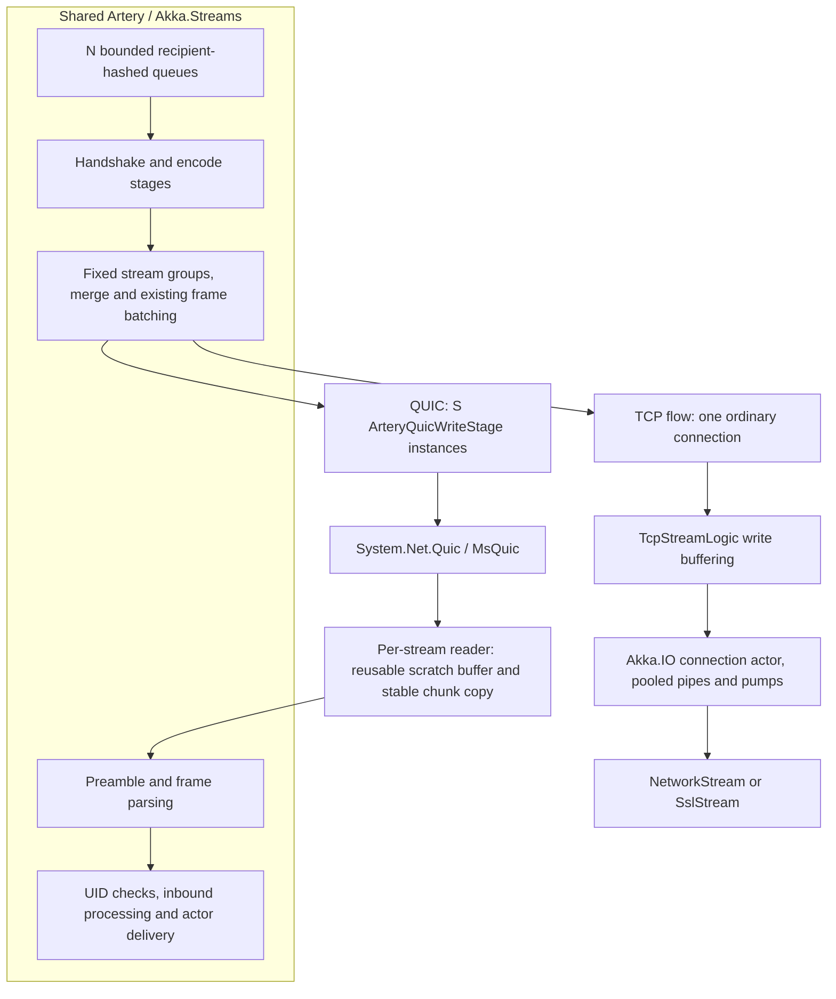
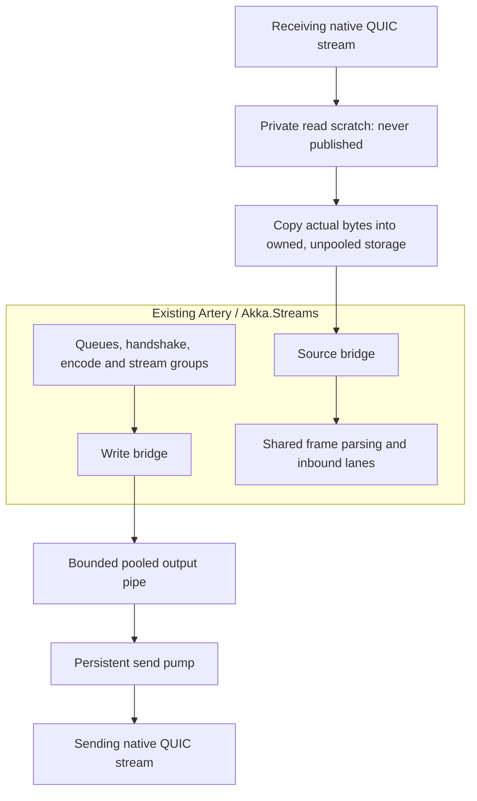
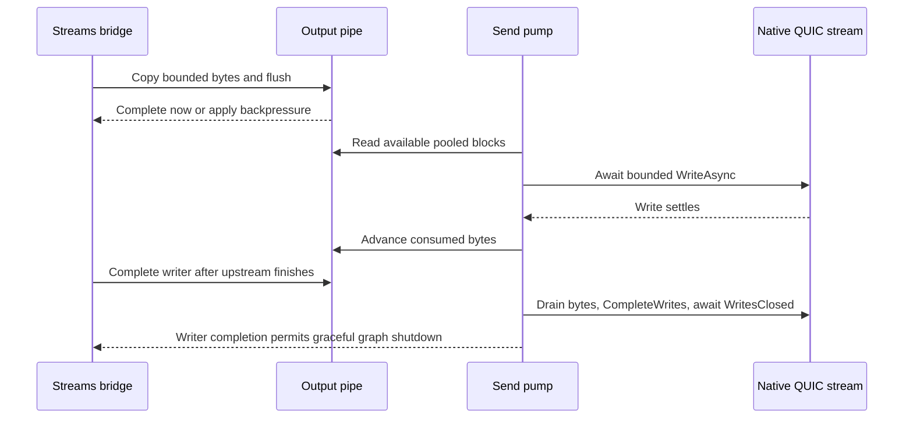
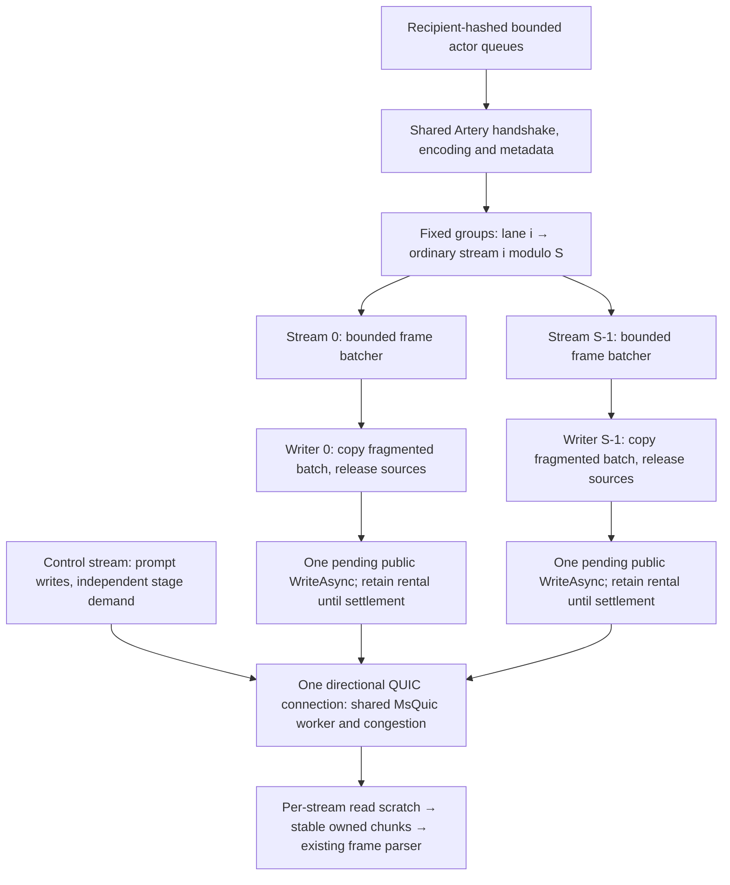
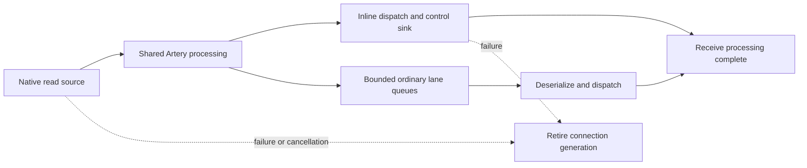

# Artery QUIC prototype

## Scope and status

The prototype adds native QUIC I/O below Artery's existing Akka.Streams graphs. It is experimental:
performance tuning and broader correctness/resource gates remain open. TCP remains the default.
This specification includes no benchmark results or machine-specific execution records.

No Aeron interoperability, HTTP/3, QUIC datagrams, 0-RTT actor traffic, connection migration,
compression implementation or production support commitment belongs to this change.

The [parallel-lane performance direction](#parallel-lane-performance-direction--2026-11-11) below
supersedes treating a pipe rewrite as the required next step. It is a design and delivery plan;
its proposed changes and verification have not been executed.

## Current architecture

Processing lanes and native streams are different quantities. Let N be the number of outbound
processing lanes and S the number of ordinary QUIC streams. Require `1 <= S <= N`, with S at most
64. A recipient keeps its existing hashed lane, and lane i writes to stream `i % S` throughout a
connection generation. Complete frames are grouped; messages are not striped round robin.



TCP keeps its existing merge/batching path. QUIC groups reuse the same handshake, encode,
test-mode and kill-switch stages. A group consumes completion markers from all its lane producers
so its MergeHub can finish, drain queued frames and send FIN.

The QUIC adapter permits one outstanding native write per stream. Ordinary multi-segment batches
up to 16 KiB use one pooled coalescing copy and one native submission. Contiguous inputs, larger
sequences and other roles retain direct segment writes.
Its read path reuses a scratch array and publishes a separate copy of the actual bytes received.
That copy is necessary because frame parsing and asynchronous consumers can retain chunk memory.

## Responsibility and ownership

| Responsibility | Owner |
|---|---|
| Routing, queues, serialization, envelope framing and metadata/compression extension points | Shared Artery graphs |
| Address/UID handshake, reliable system messages, quarantine and retries | Shared association/protocol state |
| Native connect/listen, stream admission, channel failures and final disposal | `ArteryQuicTransport` |
| Graph demand, one outstanding native write and encoded-buffer ownership | `ArteryQuicWriteStage` |
| Certificates, trust and peer identity | Existing Akka.IO policies through typed Artery TLS setup |
| TLS packet protection, congestion and native stream credit | `System.Net.Quic` / MsQuic |

Coalesced ordinary writes return original encoded owners once their bytes have been copied into
the coalescing rental. Synchronous preparation releases those source owners before submission;
only the pending native operation, rental and pool remain in the copying operation's async state.
That rental remains owned until the native write settles. Direct writes
retain their original owners through settlement. Each owner is returned once, including failures.
Cancellation must not return memory while an asynchronous operation can still use it. The
connection owner disposes native streams; individual graph stages signal retirement rather than
independently competing to dispose a shared connection.

## Connections, framing and failure

- Each node lazily owns one outbound QUIC connection per peer; reverse traffic uses the peer's
  independently dialed connection. There is no simultaneous-dial arbitration or shared bidirectional
  connection ownership in this prototype.
- Control, ordinary and optional large traffic use long-lived unidirectional streams. Ordinary
  admission has a separate configurable cap; duplicate control/large roles are rejected.
- Every stream starts with the existing five-byte Artery role preamble and then the existing
  length-prefixed envelope bytes. Native stream IDs are not Artery role IDs.
- Authentication and admission have deadlines. Accepted and outbound connection counts have finite
  limits. An unsupported platform, missing native library, incompatible protocol or unusable identity
  fails visibly; there is no TCP/plaintext fallback.
- A channel reset/failure retires its directional connection, cancels siblings and fences the old
  generation. A healthy FIN must allow sibling streams to finish independently.
- Ordinary messages gain no application-level replay or exactly-once promise. System-message
  reliability remains the shared protocol's responsibility.
- Native write completion does not establish peer application processing. Graceful drain needs the
  writer's FIN/completion signal; queue completion or an unused read outlet is insufficient.

## TLS and compatibility

Reuse `TlsCertificateLoader`, `TlsPeerPolicy`, `ArteryTlsSettings` and `ArteryTlsSetup` semantics.
Create role-appropriate native authentication options, require TLS 1.3 and prototype ALPN
`akka-artery-quic-prototype-v1`, and retain pin/custom/system trust and explicit name checks.
QUIC provides native TLS protection; it is not wrapped in an `SslStream`. Caller-owned certificates
must outlive all participating actor systems and their native I/O.

Keep canonical `akka://` addresses. All nodes must explicitly select compatible QUIC configuration;
this is not a rolling TCP-to-QUIC migration mechanism. Use a supported serviced runtime/native pair.

Telemetry and actor-ref/manifest compression belong above the adapter. Future compression-table
advertisements must be acknowledged as installed before any independent ordinary stream uses them.
Control-stream write completion alone does not establish installation. Incarnation changes must
invalidate shared table state consistently across all streams.

## Processing and comparison budgets

Artery creates its inbound consumers per accepted ordinary channel. Configuring N consumers on
each of N QUIC streams would create N squared receive paths. The comparison driver instead pairs
N TCP consumers with S QUIC streams having N/S consumers each, requiring divisibility for that sweep.
The primary sweep uses N=S=1/2/4/8 and one inline receive path per QUIC stream.

These are configured path budgets, not identical scheduling or buffering: one inbound lane processes
inline, while multiple lanes use bounded channels. Match the total outbound queue capacity by dividing
it across processing lanes. Record actual stream counts and recipient occupancy separately; do not
infer utilization from configuration alone or claim all native buffering is equivalent.

RemotePingPong preserves legacy commands and adds explicit DotNetty TCP, Artery TCP, Artery TLS TCP
and QUIC modes. Use the same realistic payload and serializer for paired comparisons. The encrypted
comparison is Artery TLS TCP versus QUIC; plaintext transports are references. Keep ping-pong and
credit-paced one-way units separate. Optional diagnostics report process CPU/allocation/GC and
ordinary QUIC I/O operations; they are separate from unprofiled throughput measurements.

## Deferred write-side alternative: pipes beneath Streams

This is a write-side research alternative, not the selected adapter or required next step.
Keep protocol stages and fixed stream routing. A future output pipe would need resource/latency
evidence against the retained writer. Receive data that escapes to parsing or actors stays in
stable, unpooled owned storage; no pooled input pipe or actor receive lease is proposed.



The receive owner may outlive the stream or actor system and is never returned to a pool.
Private scratch may be reused only after copying. The write bridge can
return original owners after copying their bytes; the send pump advances only after its native write
settles. Bound native write chunks as well as pipe payload. MsQuic can buffer whole requests past
its connection-wide target, so a managed pipe threshold is not a native memory cap.

`ITransportConnection` provides useful copy/flush and pump-completion semantics, but the concrete
`TcpTransportConnection` also owns socket/TLS shutdown behavior. Do not wrap a fake socket around
QUIC. A first experimental directional helper can stay internal to Artery, leaving TCP unchanged;
shared pump extraction requires its own regression evidence. No per-stream actor is necessary.



Primary references: [Kestrel QUIC stream pumps](https://github.com/dotnet/aspnetcore/blob/v10.0.0/src/Servers/Kestrel/Transport.Quic/src/Internal/QuicStreamContext.cs),
[MsQuic execution model](https://microsoft.github.io/msquic/msquicdocs/docs/Execution.html), and
[versioned native send buffering](https://github.com/microsoft/msquic/blob/v2.6.3/src/core/send_buffer.c).
Multiple streams provide independent ordering/credit, not automatic native CPU parallelism:
one MsQuic connection and its streams execute on one native worker at a time.

## Delivery

1. **Current prototype:** native adapter, fixed ordinary-stream groups, shared TLS policy, comparison
   source, optional diagnostics, and native correctness tests. Keep TCP/default behavior unchanged.
2. **Safety and adapter follow-up:** use the current punch list below. A write bridge/pump is only
   a deferred alternative after smaller changes. Preserve unpooled published receive storage,
   pending-write ownership, connection retirement and FIFO for every role.
3. **Performance/reliability evaluation:** warmed repeated comparisons, matched effective budgets,
   separate diagnostics and explicit invalid attempts. Native resource, lost-ACK/quarantine,
   percentile-latency and two-host/impairment gates need their own evidence before promotion.

Run the affected Artery, API approval and scoped incremental checks for code changes, plus strict
OpenSpec validation. Unsupported/skipped native tests are not native passes. Keep benchmark
execution separate from builds/tests/profiling. No performance result or default switch follows
from compilation, unit tests or this proposed architecture alone.

## Parallel-lane performance direction — 2026-11-11

### Objective and evidence boundary

Optimize the existing transport for concurrent, independently ordered Artery lanes, while preserving
control progress, bounded ownership, loaded latency and failure semantics. The retained source baseline
is `70a2ed1d6480e4657de320a824064832210dfe29`, the source in draft PR #8939. Earlier prototype
checkouts and experimental pipe branches are not the starting point. The standalone single-stream
investigation informs mechanisms; it is not an Artery benchmark or proof of a multi-stream gain.

Parallel streams are a workload assumption, not a performance guarantee. MsQuic serializes one
connection's protocol work on one worker at a time. Application stages can make concurrent progress
on different streams, but eight streams do not supply eight native protocol cores. A blocked stream
can still affect connection credit and congestion; separate control traffic on the same connection
is not a hard latency reservation. Keep one stream as a regression/control case.

### Keep the accepted structure; minimize coordination within each stream



Keep `LaneWriteBatchStage`, fixed routing, `ArteryQuicWriteStage`, the coalescing helper and
`ArteryQuicTransport` connection-generation ownership. A producer batch chains frame owners;
the writer coalesces small fragmented batches into one contiguous native submission. The accepted
helper releases original owners before submission and keeps only the rental until completion.
Do not add a second accumulation queue or hold both representations longer to simplify a pump.

Batch already available ordinary traffic while downstream is busy, dispatch promptly when idle,
and preserve per-lane FIFO. Never wait for every lane, fill a batch on a timer, or merge independent
stream groups through a common writer barrier. Control retains prompt dispatch. Preserve the existing
16 KiB batching/coalescing caps and oversized/direct-write path for the first change. A larger
application write cap is a later controlled variable, not a consequence of adding more streams.

The concrete first code change is to move linked cancellation state from each write to the lifetime
of its opened channel. All writes in that stage already link the same stage-stop and channel-generation
tokens. This targets repeated adapter allocation while leaving byte geometry and ownership unchanged:

```text
Current, for every input batch:
  create linked cancellation(stage stop, channel generation)
  prepare/copy using accepted helper; await one native write; dispose linked cancellation

Proposed:
  when channel opens: create the linked cancellation once
  for every batch: use that token with the same preparation/write helper
  on stop/reset: cancel via the same owners, retire according to current policy
  after all initialization/write/finish/monitor operations settle: dispose linked cancellation
```

Do not change faulted versus canceled completion status or the helper's exception handling. The
standalone cancellation experiment reduced allocation without demonstrating throughput improvement;
this small adapter change is an allocation hypothesis, not an established speedup or a fix for native
worker saturation. Reject it if cancellation/lifetime behavior or measured resource use worsens.

### Ownership, bounded memory and receive-side constraints

Each stream retains its own write credit, pending native input and stage demand. Other streams must
not await its stage callback. Keep admission/shutdown coordination with the connection owner; do not
introduce a connection-wide lock or wait around native writes. Generation retirement still cancels
siblings on failure, so lane independence applies to healthy operation, not survival of a reset peer.

Account per peer and per direction: queued encoded owners, batcher-held inputs, active coalescing
rentals and any proposed pipe pages. Count written bytes and actual leased backing-array capacity
separately; do not count a batch's chained owners twice. Retained capacity includes idle per-stream
buffers, so a permanent 16 KiB rental per stream is not automatically a memory optimization. Existing
queue-entry limits are not byte caps, and managed limits do not cap native/kernel storage. Hold the
aggregate queue budget fixed while varying S; do not multiply buffers silently with stream count.

**Receive ownership is a design constraint:** keep the current stable inbound chunk copy in
unpooled owned storage. Actors and parsers may retain the published bytes indefinitely, including
after stream/system shutdown. Do not publish pooled receive arrays or pipe segments, require actor
receive leases/disposal acknowledgments, or return storage according to native-read completion.
A private reusable scratch array is allowed only because its bytes are copied before publication.
Pooled writes remain allowed: source owners can be released after copying, while the native input
rental remains leased until the write actually settles, even if cancellation was requested.
A permanent coalescing rental or output pump still needs resource evidence; an input-pipe or
receive-lease redesign is excluded by the requested ownership policy.

### Delivery

**Next PR: channel-lifetime cancellation state.** Start from the retained baseline in an isolated
checkout, reproduce the existing source gates, freeze the control, then change only cancellation
ownership in `ArteryQuicWriteStage`. Add focused cancellation/reset/cleanup cases in
`ArteryQuicTransportSpec`; retain coalescing-copy failures and canceled-status assertions. No wire,
public API, TCP, topology, batch-cap, scheduler or buffer-pool changes belong in this PR. Intermediate
behavior uses the same writer and byte layout with one linked token source per opened stage/channel.
Reverting the small change restores prior cancellation ownership without a compatibility migration.

Before promotion, run:

```sh
dotnet test src/core/Akka.Remote.Tests/Akka.Remote.Tests.csproj -c Release --framework net10.0 --filter FullyQualifiedName~ArteryQuicTransportSpec
dotnet test src/core/Akka.Remote.Tests/Akka.Remote.Tests.csproj -c Release --framework net10.0 --filter FullyQualifiedName~ArteryQuicStreamsSpec
dotnet test src/core/Akka.Remote.Tests/Akka.Remote.Tests.csproj -c Release --framework net10.0 --filter FullyQualifiedName~Artery
dotnet test src/core/Akka.API.Tests/Akka.API.Tests.csproj -c Release --framework net10.0
```

Use a host with working native QUIC, prepared test credentials and the pinned runtime/native files.
Zero native skips are required. Extend the existing controlled delayed-write fixture: block a native
write, cancel stage/channel separately, verify cancellation reaches it, prevent reuse of the active
rental, settle it, and assert exactly-once owner return. Repeat reset/reconnect with a new channel;
old cancellation must not cancel the new generation. Include stop-before-open and finish-before-open.
Retain the real-native blocked-reader/control-and-healthy-stream test. These are procedures to execute
on the candidate, not claims that the new behavior has passed. Perform Slopwatch, scoped incremental
checks and independent ownership/evidence review before calling the slice verified.

**Contemporary performance control.** Use the existing RemotePingPong rotated comparison driver;
first confirm the retained QUIC baseline against encrypted Artery TCP with eight outbound processing
lanes, eight total receive processing paths, and S=1/2/4/8. The existing recipe is:

```sh
python3 src/benchmark/RemotePingPong/compare_transports.py --phase transports \
  --binary src/benchmark/RemotePingPong/bin/Release/net10.0/RemotePingPong.dll \
  --pattern oneway --clients 128 --window 10 --messages 37500 \
  --repetitions 5 --lanes 8 --quic-stream-counts 1 2 4 8 --queue-budget 8192 \
  --output /tmp/artery-parallel-lane-control
```

Use a fresh output directory; extend equal message counts for all arms if any measurement is under
three seconds. Verify actual stream counts, recipient occupancy in both directions and receive-path
budgets. For QUIC, inbound lanes per stream are 8/S, not eight for each stream. Keep TCP at eight
processing lanes with its ordinary connection topology unchanged. Include the driver's plaintext
arms as labeled context only; encrypted TCP is the security-matched comparison.

Then use the retained paired frozen-build experiment controller for candidate versus control at S=8,
with S=1 as a regression guard. Record its exact private command/source/hash before execution; that
private controller is not a portable repository deliverable. If unavailable, parameterize the existing
comparison tooling for two frozen builds before attempting this acceptance comparison. Do not invent
an executable command or silently use unmatched harness revisions. Primary timings have allocation,
progress and profiling diagnostics off. Measure allocations, write sizes/counts, endpoint CPU and
leased capacity in separate blocks. Retain failed runs and paired differences, not fastest attempts.
Keep builds, analysis, journal writes and other owned work outside measurement intervals.

Reuse the existing private paced-RTT and leased-capacity fixtures with matched control/candidate:
sparse traffic, equal offered-load bursts, and a slow ordinary reader while control and another lane
remain active. Preserve sequence/duplicate, drop, shutdown and zero-leased-owner checks. The public
harness lacks some of these private acceptance modes: port the relevant fixture if needed rather
than describe `--pattern ping-pong` as an offered-load tail-latency test. No acceptance threshold is
relaxed by this plan. Mixed or overlapping results stay inconclusive; an allocation reduction alone
is not a throughput claim. Stop on correctness/security/pin failures. No wholesale historical rerun.

**Later PR, only if selected by those observations: ordinary batch geometry.** Hold processing lanes,
S, aggregate queue budget and protocol constant. Separate producer batching from the native coalescing
cap; change one at a time. Measure real bytes/submission, CPU, paired throughput, sparse/loaded p99
and outstanding leased capacity against the contemporary predecessor. Preserve immediate idle and
control behavior. Reuse the batcher/coalescing helper before considering a new pipe. Revert or narrow
an experiment whose gain requires unacceptable tail latency, retained capacity or lost fairness.

**Deferred alternatives.** A bounded persistent pump/pipe is reasonable only if adapter handoffs or
write geometry are still limiting and a smaller change fails; prior pipe trials do not establish an
acceptable replacement. Native execution-profile controls belong to the standalone/custom-runtime
study. Connection striping changes topology and would need equally striped TCP controls and new
ordering/failure analysis. Scheduler tuning is outside this sequence; pooled published receives and receive leases are excluded.
TCP remains default and this remains an experimental transport; no production cutover is authorized.

### Source leads and falsification

[MsQuic execution](https://github.com/microsoft/msquic/blob/v2.6.3/docs/Execution.md),
[.NET send buffer ownership](https://github.com/dotnet/runtime/blob/v10.0.14/src/libraries/System.Net.Quic/src/System/Net/Quic/Internal/MsQuicBuffers.cs),
and [Kestrel's stream loops](https://github.com/dotnet/aspnetcore/blob/v10.0.0/src/Servers/Kestrel/Transport.Quic/src/Internal/QuicStreamContext.cs)
explain mechanisms, not the speed of this adapter. Check their exact deployed versions for every run.
A loopback gain does not prove lane isolation under loss. Use the existing blocked-reader native test
for the immediate correctness boundary; two-host impairment/fairness work requires an isolated host
or network namespace and a separately specified setup. Do not modify shared host qdiscs casually.
If increasing S does not improve the relevant workload, or loaded latency/capacity regresses, revise
the recommendation instead of assuming parallel streams must win. This plan executes no benchmarks.

## Safety punch list and multi-node coverage

The receive-ownership policy above is maintainer direction, not an optional optimization tradeoff.
A throughput improvement cannot weaken it. Existing write pooling remains supported with explicit
ownership through settlement. The following work is separate from claiming a faster adapter:

1. **Protect retained receive bytes.** Extend the stable-chunk test to retain several received
   messages while subsequent reads, FIN, reset and system termination occur. Retained bytes must
   remain exact without actor disposal or receive acknowledgments. Keep private scratch reuse
   separate from published storage. This applies across frame parsing and actor delivery boundaries.
2. **Preserve pooled write safety.** Retain delayed-write/ignored-cancellation and rent/copy/submission
   failure cases. Assert no active native input is returned early, each owner returns once, and old
   generation callbacks/cancellation cannot affect a restarted channel. Moving linked cancellation
   to channel lifetime must pass these cases before performance selection.
3. **Add an opt-in QUIC multi-node arm.** Extend the existing internal transport selection in
   `src/core/Akka.Remote.TestKit/MultiNodeSpec.cs`, where `AKKA_MNTR_TRANSPORT=artery` currently selects
   Artery TCP. The explicit `artery-quic` mode is now implemented. Retain the unset/classic and artery
   modes; reject unsupported requested values rather than silently run another transport. Keep
   runner/conductor coordination unchanged; select QUIC for the actor remoting under test.
   Initial `MultiNodeSpec` actor-system creation and `StartNewSystemAsync` must both receive the
   typed `ArteryTlsSetup`; copying HOCON alone does not copy that bootstrap object. Provide test-only
   credentials/trust through existing Akka.IO policy primitives, with bounded lifecycle and consistent
   trust across roles. Never disable certificate validation to make the suite run. Cover additional
   systems created directly by individual specs as an explicit audit, not an assumed helper benefit.
4. **Prove which multi-node tests actually use QUIC.** Each role reports effective transport and
   native availability; require the intended QUIC roles before counting coverage. Missing credentials,
   unsupported native prerequisites or failed startup cannot become passing QUIC evidence. Respect
   explicit per-spec transport overrides and report classic-only specs separately. The existing Artery
   test transport implements blackhole/pass-through, while rate-throttle specs can be pinned to
   classic; do not claim QUIC throttling coverage from those runs. Config-precedence checks need
   unset/classic, artery TCP, QUIC and explicit classic overrides, plus negative invalid-mode/identity
   cases. Restart checks must verify QUIC remains active with correct identity and a fresh UID.
5. **Exercise distributed failure and shutdown before qualification.** Start a bounded remote/cluster
   subset covering ordered numbered delivery, remote DeathWatch, restart/new UID, quarantine,
   reliable system-message retries and blackhole/heal, then expand compatible suites. Add distinct
   one-stream and parallel-stream cases, a blocked ordinary reader with healthy-lane/control progress,
   and teardown with queued traffic plus a surviving recipient. The current prototype can close its
   connection before the peer consumes buffered ordinary data; native send completion/FIN alone is
   not application delivery confirmation. Keep this gap explicit and resolve its protocol/timeout
   semantics separately from buffer optimization. Ordinary messages acquire no replay guarantee.
6. **Keep performance acceptance separate.** Fresh paired throughput, CPU, loaded/sparse latency,
   actual write geometry and aggregate outstanding leased capacity remain required for a selected
   optimization. Multi-node correctness success is not a performance result. No whole-suite QUIC,
   impairment, native resource or production-readiness claim follows from this planning update.

The multi-node arm is a bounded enabling change before expanding distributed qualification. Reuse
existing remote/cluster specifications and TestConductor fault controls rather than invent a second
runner. Credential fixture/configuration tests come before native smoke tests, followed by compatible
multi-node subsets. Existing TCP/classic behavior remains covered throughout. The authenticated opt-in runner foundation is now implemented; the contributor
[build guide](../../../docs/community/contributing/build-process.md#opt-in-artery-quic-coverage)
documents credentials, native prerequisites, child-runtime selection and coverage limits. Initial,
restarted and migrated extra-system paths use the same TLS-aware factory. Effective transport is
reported from the actual provider, and explicit classic overrides retain precedence. Factory-owned
credentials survive asynchronous failed-start cleanup and are released on system termination;
caller-supplied TLS setup remains caller-owned. Canceled conductor attachment terminates its created
system before returning failure. These changes preserve the existing default transport and test
configuration precedence. Peer-consumed shutdown and broader distributed/resource stress remain open.

### Receive Completion Before Peer Progress

The QUIC adapter's inbound callback returns the processing task for the accepted source. Remoting
materializes the sink's completion and, when ordinary inbound lanes are enabled, waits for all of
that stream's lane consumers after their writers close. The consumer observer is opt-in for QUIC;
the default TCP path does not retain a lane-task array. Existing per-frame deserialization failures
remain isolated drops, rather than acquiring replay semantics.



Source termination and downstream completion are observed separately. A failed or cancelled source
must retire its connection promptly even if a serializer or lane consumer is blocked. Native
cleanup cancels those observer waits; underlying processing tasks remain observed and may outlive
native teardown. Published chunks retain their owned, unpooled storage throughout.

This completion task establishes a local receive boundary. It does not send a receipt to the peer,
wait for actor business processing, or resolve the shutdown gap by itself. A subsequent peer-progress
protocol must order its barrier after data on every active stream, include lane dispatch, correlate
receipts with the current peer and generation, and preserve a bounded authenticated reply path
during simultaneous shutdown. Missing receipts, reset and timeout cannot count as graceful receipt.
